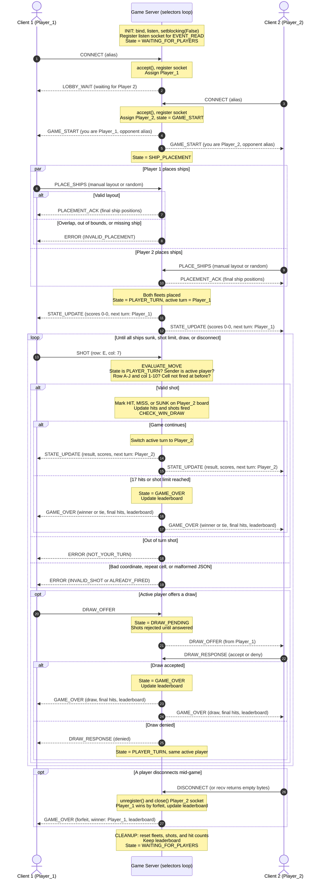

**Student:** Gale Wing
**Course:** CS 457 - Computer Networks
**Game:** Battleship

## 1. Overview

This document explains sprint 2 requirements regarding how the Battleship server handles two simultaneous client connections, enforces turns, keeps game state consistent, and broadcasts state and score updates to both players.

The server uses non-blocking I/O multiplexing with Python's `selectors` module. All sockets are serviced by one event loop running in a single thread. There are no worker threads, so all game state is owned by that one thread.
---

## 2. Server Concurrency Architecture & Connection Lifecycle

### 2.1 Why `selectors`
Battleship is a game involving two players taking strict turns and has explicit rules of operation between interactions, this makes selectors a very good fit to use for the game as the way they behave fits the rules of the game. The server spends most of its time waiting instead of working, so using selectors will have one loop watching both client sockets and the listening sockets,and will only wake up when one of them has data ready. A slow player will not hold up the server or slow down their opponent, and all the behavior can fit in a single loop that holds the entire game state. Every message can be handled against a single consistent board and supports an authoritative server enforcing turns and rejecting invalid shots. Processing events one at a time also enforces the FSM, since each incoming message causes at most one state transition. The per-connection receive and send buffers that selectors requires are the same buffers the newline framing rule already uses. Battleship being turn-based and low-traffic allows for one single-threaded event loop to handle the entire game state since only one meaningful move occurs at any time, and avoids the locks that a threaded design would need. 


### 2.2 How the event loop avoids blocking

- The listening socket and every accepted client socket are put into non-blocking mode with `sock.setblocking(False)`.
- Each socket is registered with a `selectors.DefaultSelector()`.
- Each loop iteration calls `sel.select(timeout=1.0)`. The call returns only the sockets that are ready to read or write, so the server never waits on a single slow or idle client.
- Because sockets are non-blocking, `recv()` and `send()` return immediately with whatever data is available, or raise `BlockingIOError`, which the server treats as "try again next iteration."
- The one-second timeout lets the loop wake up periodically even when no traffic arrives, which leaves room for housekeeping such as idle-client timeouts.

### 2.3 Server data structures

Each connected socket is registered with a `ClientConn` object as its selector `data`:

```python
class ClientConn:
    sock: socket.socket
    addr: tuple            # (ip, port)
    inbuf: bytearray       # bytes received in an unfinished line
    outbuf: bytearray      # bytes queued to send
    player_id: str         # "UNASSIGNED", "Player_1", or "Player_2"
    alias: str             # name from the CONNECT payload
```

All game state lives in a single `GameSession` object owned by the event loop:

```python
class GameSession:
    state: str                  # FSM state, i.e. "WAITING_FOR_PLAYERS", "PLAYER_TURN"
    players: dict               # {"Player_1": ClientConn, "Player_2": ClientConn}
    fleets: dict                # {"Player_1": {ship_name: set_of_cells}, ...}
    placed: set                 # player_ids whose PLACE_SHIPS was accepted
    shots_received: dict        # {"Player_1": set_of_cells_fired_at_this_board, ...}
    active_turn: str            # "Player_1" or "Player_2"
    hits: dict                  # {"Player_1": 0, "Player_2": 0}  (hits landed this game)
    shots_fired: dict           # {"Player_1": 0, "Player_2": 0}
    draw_offered_by: str | None # set while in DRAW_PENDING

leaderboard: dict  # {alias: {"wins": 0, "losses": 0, "draws": 0}}, lives for the server's lifetime
```

---


