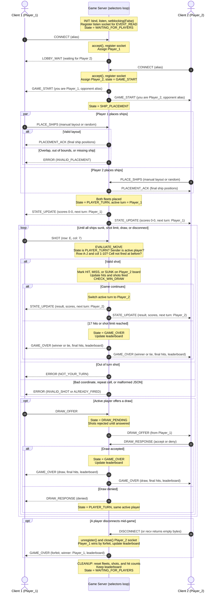

**Student:** Gale Wing
**Course:** CS 457 - Computer Networks
**Game:** Battleship

## 1. Overview

This document explains sprint 2 requirements regarding how the Battleship server handles two simultaneous client connections, enforces turns, keeps game state consistent, and broadcasts state and score updates to both players.

The server uses non-blocking I/O multiplexing with Python's `selectors` module. All sockets are serviced by one event loop running in a single thread. There are no worker threads, so all game state is owned by that one thread.

---

## 2. Server Concurrency Architecture

### 2.1 Why `selectors`
Battleship is a game involving two players taking strict turns and has explicit rules of operation between interactions, this makes selectors a very good fit to use for the game as the way they behave fits the rules of the game. The server spends most of its time waiting instead of working, so using selectors will have one loop watching both client sockets and the listening sockets,and will only wake up when one of them has data ready. A slow player will not hold up the server or slow down their opponent, and all the behavior can fit in a single loop that holds the entire game state. Every message can be handled against a single consistent board and supports an authoritative server enforcing turns and rejecting invalid shots. Processing events one at a time also enforces the FSM, since each incoming message causes at most one state transition. The per-connection receive and send buffers that selectors requires are the same buffers the newline framing rule already uses. Battleship being turn-based and low-traffic allows for one single-threaded event loop to handle the entire game state since only one meaningful move occurs at any time, and avoids the locks that a threaded design would need. 


### 2.2 How the event loop avoids blocking

- The listening socket and every accepted client socket are put into non-blocking mode with `sock.setblocking(False)`.
- Each socket is registered with a `selectors.DefaultSelector()`.
- Each loop iteration calls `sel.select(timeout=1.0)`. The call returns only the sockets that are ready to read or write, so the server never waits on a single slow or idle client.
- Because sockets are non-blocking, `recv()` and `send()` return immediately with whatever data is available, or raise `BlockingIOError`, which the server treats as "try again next iteration."
- The one-second timeout lets the loop wake up periodically even when no traffic arrives, which leaves room for housekeeping such as idle-client timeouts.

### 2.3 Server data structures

Each connected socket is registered with a `ClientConn` object as its selector `data`:

```python
class ClientConn:
    sock: socket.socket
    addr: tuple            # (ip, port)
    inbuf: bytearray       # bytes received in an unfinished line
    outbuf: bytearray      # bytes queued to send
    player_id: str         # "UNASSIGNED", "Player_1", or "Player_2"
    alias: str             # name from the CONNECT payload
```

All game state lives in a single `GameSession` object owned by the event loop:

```python
class GameSession:
    state: str                  # FSM state, i.e. "WAITING_FOR_PLAYERS", "PLAYER_TURN"
    players: dict               # {"Player_1": ClientConn, "Player_2": ClientConn}
    fleets: dict                # {"Player_1": {ship_name: set_of_cells}, ...}
    placed: set                 # player_ids whose PLACE_SHIPS was accepted
    shots_received: dict        # {"Player_1": set_of_cells_fired_at_this_board, ...}
    active_turn: str            # "Player_1" or "Player_2"
    hits: dict                  # {"Player_1": 0, "Player_2": 0}  (hits landed this game)
    shots_fired: dict           # {"Player_1": 0, "Player_2": 0}
    draw_offered_by: str | None # set while in DRAW_PENDING

leaderboard: dict  # {alias: {"wins": 0, "losses": 0, "draws": 0}}, lives for the server's lifetime
```

---

## 3. Connection Lifecycle

### 3.1 Startup (FSM state `INIT`)

1. Create a TCP socket, set `SO_REUSEADDR`, `bind()` to the server address (`192.168.20.100` in the CML topology, resolved by clients as `server.wing.edu`), and `listen()`.
2. Call `setblocking(False)` on the listening socket.
3. Register the listening socket with the selector for `EVENT_READ`, with `data=None` to mark it as the listener.
4. Set the session state to `WAITING_FOR_PLAYERS` and enter the event loop.

### 3.2 Accept and registration (FSM state `WAITING_FOR_PLAYERS`)

When the listening socket is readable, a client is connecting:

1. Call `accept()`, set the new socket non-blocking, and register it for `EVENT_READ` with a new `ClientConn` (`player_id = "UNASSIGNED"`).
2. The client then sends `CONNECT` with its alias. The server handles it as follows:
   - **First player:** assigned `Player_1`, and the server queues `LOBBY_WAIT`.
   - **Second player:** assigned `Player_2`. The session moves to `GAME_START`, and the server queues `GAME_START` to both clients (each payload says which player they are and gives the opponent's alias). The session then moves to `SHIP_PLACEMENT`.
   - **Third or later connection:** the server queues `ERROR` with code `GAME_FULL`, flushes it, then unregisters and closes that socket. The server supports exactly two players per game, and extra connections never touch game state.
3. Any message other than `CONNECT` from an `UNASSIGNED` client is answered with `ERROR` (`NOT_CONNECTED`).

### 3.3 Active servicing (FSM states `SHIP_PLACEMENT` through `GAME_OVER`)

**Read path (`EVENT_READ` on a client socket):**

1. `data = sock.recv(4096)`.
2. If `data` is empty, the client closed the connection, so go to teardown (Section 3.4).
3. Append `data` to `conn.inbuf`.
4. While `inbuf` contains `\n`, split off one complete line, decode it as UTF-8, and parse the JSON. Bytes after the last `\n` stay in `inbuf` until the rest of the message arrives, exactly as the Sprint 1 framing rule requires.
5. Malformed JSON, or a JSON object missing `msg_type`, `player_id`, or `payload`, gets `ERROR` (`MALFORMED_MESSAGE`). The connection stays open.
6. Each valid message is passed to `dispatch(conn, msg)`, which runs the handler for that `msg_type` (Section 5).

**Write path (`EVENT_WRITE` on a client socket):**

1. Handlers never call `send()` directly. They append encoded messages to `conn.outbuf` through `queue_message()` and `broadcast()`.
2. When `outbuf` becomes non-empty, the socket's registration is changed to `EVENT_READ | EVENT_WRITE` with `sel.modify()`.
3. When the socket is writable, `sent = sock.send(conn.outbuf)` and the sent bytes are removed from the front of the buffer. A partial send is normal, and the remainder goes out on a later iteration.
4. When `outbuf` is empty again, the registration goes back to `EVENT_READ` only, so the loop doesn't spin on an always-writable socket.

### 3.4 Teardown

Teardown happens on any of the following:

- a `DISCONNECT` message,
- `recv()` returning empty bytes,
- `ConnectionResetError` or another `OSError` on `recv()` or `send()`,
- rejection of an extra connection (`GAME_FULL`).

The steps are:

1. `sel.unregister(sock)`, then `sock.close()`.
2. Remove the connection from `session.players`.
3. If a game was in progress (`SHIP_PLACEMENT`, `PLAYER_TURN`, `DRAW_PENDING`), the remaining player wins by forfeit. The server updates the leaderboard and queues `GAME_OVER` (reason `FORFEIT`) to the remaining player.
4. The session moves to `CLEANUP`: fleets, shots, hit counts, and the draw flag are reset. The leaderboard is kept. The session returns to `WAITING_FOR_PLAYERS`, with the remaining player (if any) re-registered as `Player_1` and sent `LOBBY_WAIT`.

### 3.5 Event loop sketch

```python
sel = selectors.DefaultSelector()
sel.register(listen_sock, selectors.EVENT_READ, data=None)

while running:
    for key, mask in sel.select(timeout=1.0):
        if key.data is None:
            accept_client(key.fileobj)
            continue
        conn = key.data
        if conn.closed:                 # torn down earlier in this same batch
            continue
        if mask & selectors.EVENT_READ:
            handle_read(conn)           # recv, frame, dispatch (handlers run to completion)
        if mask & selectors.EVENT_WRITE and not conn.closed:
            handle_write(conn)          # flush outbuf, partial sends allowed
```

The `conn.closed` check matters: `select()` returns a batch of ready sockets, and handling one event (for example, Player 2 disconnecting) can close a socket that appears later in the same batch. Skipping closed connections prevents operating on a dead socket.

---

### 4.1 Shared resources

| Resource | Read by | Written by | Corruption risk if handled concurrently |
|---|---|---|---|
| `session.fleets` (ship grids) | `SHOT` handler | `PLACE_SHIPS` handler, `CLEANUP` | A shot evaluated against a half-written fleet |
| `session.shots_received` (shot boards) | `SHOT` handler | `SHOT` handler, `CLEANUP` | The same cell counted as a hit twice |
| `session.active_turn` | `SHOT`, `DRAW_OFFER` handlers | `SHOT` handler | Both players firing on the same turn |
| `session.state` (FSM state) | Every handler | Most handlers, teardown | A shot accepted after `GAME_OVER` |
| `session.hits`, `session.shots_fired` | `SHOT` handler, broadcasts | `SHOT` handler, `CLEANUP` | Scores out of sync with the board |
| `session.players` (client list) | `broadcast()` | Accept, teardown | A broadcast to a socket that was just closed |
| `leaderboard` | `GAME_OVER` broadcast | Game end, forfeit | A lost win or loss update |
| Per-connection `inbuf` / `outbuf` | Read/write paths | Read/write paths, handlers | Interleaved bytes from two messages |

### 4.2 Why no locks are needed

With `selectors`, every resource above is touched by exactly one thread: the event loop. That gives the server a **run-to-completion** guarantee:

- The loop handles one ready event at a time.
- When a complete message is dispatched, its handler validates the message, mutates state, and queues every resulting message (to one or both clients) **before** control returns to the loop.
- No other message, from either client, can be processed partway through a handler.

This means the classic race in a threaded server, where both players' `SHOT` messages are checked against `active_turn` at the same moment and both pass, cannot happen. If both messages arrive in the same `select()` batch, they are still dispatched one after the other. The first changes `active_turn`, and the second fails the turn check and receives `ERROR`.

Each handler is effectively a critical section that the event loop guarantees for free, without `threading.Lock`. The design rule that keeps this guarantee true is: **handlers never block and never yield partway through a state change.** They do no `time.sleep()`, no blocking socket calls, and no waiting for user input.

### 4.3 Hazards specific to the event-loop model, and mitigations

| Hazard | Mitigation |
|---|---|
| A message split across several `recv()` calls | Per-connection `inbuf`, and only complete `\n`-terminated lines are parsed |
| Several messages arriving in one `recv()` | The framing loop processes every complete line in `inbuf`, in order |
| `send()` sending only part of a message | Per-connection `outbuf`, with leftover bytes flushed on the next `EVENT_WRITE` |
| A slow handler stalling both players | Handlers do only in-memory work, with no blocking calls |
| A client that connects and never sends anything | The `select()` timeout lets the loop check idle time and drop clients that never send `CONNECT` |
| A socket closed earlier in the same `select()` batch | The `conn.closed` check before servicing (Section 3.5) |
| Disconnect in the middle of a game | Teardown declares a forfeit, broadcasts `GAME_OVER`, and resets through `CLEANUP` |
| A malicious or buggy client spamming messages | Every message is validated against the FSM state, and anything invalid only produces `ERROR` |

If a later sprint adds a background thread (for example, a console for the server operator), that thread will not touch `GameSession` directly. It will pass requests to the event loop through a thread-safe `queue.Queue`, so the single-owner rule still holds.

---

## 5. Move Validation & Turn Enforcement

### 5.1 Ship placement (`SHIP_PLACEMENT`)

`PLACE_SHIPS` is accepted only in `SHIP_PLACEMENT`, and only once per player. The server checks that all five ships are present (Carrier 5, Battleship 4, Cruiser 3, Submarine 3, Destroyer 2), that each ship is horizontal or vertical, within A-J and 1-10, and that no ships overlap. A `random` request is generated on the server and checked the same way.

- **Valid:** the fleet is stored, and the server replies with `PLACEMENT_ACK` containing the final positions.
- **Invalid:** the server replies with `ERROR` (`INVALID_PLACEMENT`). The player stays in `SHIP_PLACEMENT` and can resend.

When both players are in `session.placed`, the state becomes `PLAYER_TURN` with `active_turn = "Player_1"`, and the server broadcasts an initial `STATE_UPDATE` (no shot result, scores 0-0, turn `Player_1`).

### 5.2 Shot validation order (`PLAYER_TURN` → `EVALUATE_MOVE`)

For every `SHOT`, the handler runs these checks in order. The first failure returns `ERROR` to the sender only, and **no state is changed**:

1. **State check:** `session.state == "PLAYER_TURN"`. Otherwise `ERROR` (`INVALID_STATE`). This covers shots during placement, during a pending draw, or after the game ended.
2. **Identity check:** the `player_id` in the message matches the player assigned to this connection. The server trusts the connection, not the claimed ID, so a client can't impersonate its opponent. Otherwise `ERROR` (`INVALID_PLAYER`).
3. **Turn check:** the sender is `session.active_turn`. Otherwise `ERROR` (`NOT_YOUR_TURN`).
4. **Coordinate check:** `row` is a letter A-J and `col` is an integer 1-10. Otherwise `ERROR` (`INVALID_SHOT`).
5. **Repeat check:** the cell is not already in the opponent's `shots_received`. Otherwise `ERROR` (`ALREADY_FIRED`).

### 5.3 State mutation (`EVALUATE_MOVE` → `CHECK_WIN_DRAW`)

If all checks pass, in the same handler call:

1. Add the cell to the opponent's `shots_received` and increment the shooter's `shots_fired`.
2. If the cell belongs to a ship, it's a `HIT`: increment the shooter's `hits`. If every cell of that ship has now been hit, the result is `SUNK` with the ship's name. Otherwise the result is `MISS`.
3. **Win check:** if the shooter's `hits` reaches 17, the shooter wins.
4. **Shot-limit check:** if both players have used all 50 shots, the player with more hits wins, and equal hits is a tie.
5. If the game is over, the state becomes `GAME_OVER`, the leaderboard is updated, and `GAME_OVER` is broadcast. Otherwise `active_turn` switches to the opponent and `STATE_UPDATE` is broadcast.

### 5.4 Draw offers (`DRAW_PENDING`)

Only the active player can send `DRAW_OFFER`, and only in `PLAYER_TURN`. The server sets `draw_offered_by`, moves to `DRAW_PENDING`, and relays `DRAW_OFFER` to the opponent. While the draw is pending, `SHOT` messages from either player are rejected with `ERROR` (`INVALID_STATE`).

- **Accepted:** the state becomes `GAME_OVER` and `GAME_OVER` (reason `DRAW`) is broadcast.
- **Denied:** `DRAW_RESPONSE` (denied) is relayed to the offering player, and the state returns to `PLAYER_TURN` with the same active player.

A `DRAW_RESPONSE` from the player who made the offer, or when no offer is pending, gets `ERROR` (`INVALID_STATE`).

---

## 6. Score & Leaderboard Synchronization

### 6.1 Where scores live in server memory

- **Per-game score:** `session.hits` and `session.shots_fired`, keyed by `player_id`, plus remaining ship cells (17 minus hits taken). These reset in `CLEANUP`.
- **Leaderboard:** the `leaderboard` dict, keyed by player alias, with wins, losses, and draws. It is updated exactly once per game, at the transition to `GAME_OVER` (including forfeits and accepted draws), and lasts for the lifetime of the server process.

Only the `SHOT` handler, the `DRAW_RESPONSE` handler, and teardown write these values, and all of them run on the event-loop thread.

### 6.2 What gets broadcast

Scores travel inside the existing Sprint 1 message types, so no new message type is needed.

`STATE_UPDATE`, sent to both players after every accepted shot:

```json
{
  "msg_type": "STATE_UPDATE",
  "player_id": "SERVER",
  "payload": {
    "shooter": "Player_1",
    "target": {"row": "E", "col": 7},
    "result": "SUNK",
    "ship_sunk": "Destroyer",
    "scores": {
      "Player_1": {"hits": 6, "shots_fired": 14, "cells_remaining": 15},
      "Player_2": {"hits": 2, "shots_fired": 13, "cells_remaining": 11}
    },
    "next_turn": "Player_2"
  },
  "timestamp": 1920000105
}
```

`GAME_OVER`, sent to both players at the end of a round:

```json
{
  "msg_type": "GAME_OVER",
  "player_id": "SERVER",
  "payload": {
    "reason": "ALL_SHIPS_SUNK",
    "winner": "Player_1",
    "final_hits": {"Player_1": 17, "Player_2": 11},
    "leaderboard": {
      "Edgar": {"wins": 2, "losses": 1, "draws": 0},
      "Lenore": {"wins": 1, "losses": 2, "draws": 0}
    }
  },
  "timestamp": 1920000400
}
```

`reason` is one of `ALL_SHIPS_SUNK`, `SHOT_LIMIT`, `DRAW`, or `FORFEIT`. `winner` is `null` for a tie or an accepted draw.

`STATE_UPDATE` reports the shot cell and result to both players, but never sends ship positions. Each client keeps only its own fleet (from `PLACEMENT_ACK`) and builds its view of the opponent's board from the results it's told about. Ship locations never cross the network to the wrong player.

### 6.3 Broadcast mechanism and the synchronization guarantee

```python
def broadcast(msg_type, payload):
    line = (json.dumps({...}) + "\n").encode("utf-8")   # encoded once
    for conn in session.players.values():
        conn.outbuf += line
        sel.modify(conn.sock, selectors.EVENT_READ | selectors.EVENT_WRITE, data=conn)
```

Within one handler call, the server encodes the message once and appends the same bytes to both players' send buffers, before the loop processes any other event. That provides these guarantees:

- **Same content:** both players receive byte-for-byte identical state for every update.
- **Same order:** TCP preserves ordering on each connection, and both buffers receive updates in the same sequence, so neither client can see update N+1 before update N.
- **No stale actions:** the turn has already switched in server memory before either client is told about it. A client acting on the previous turn is rejected by the turn check.
- **Atomic with the state change:** no other message is processed between the state change and the queuing of the broadcast.

Physical delivery to two different machines can differ by a few milliseconds because of the network. The protocol doesn't depend on simultaneous arrival, only on both clients receiving the same updates in the same order. Since the server is the only authority on the board, a client that is a few milliseconds behind can't corrupt anything.

---

## 7. Sequence Diagram

The diagram shows one full game: connecting and the lobby, ship placement, the shot loop with valid and rejected moves, draw offers, the end of the game, and disconnects. Shots are shown from Player 1's side, and Player 2's turns mirror them.



### 7.1 Narrative

**Connecting and the lobby.** Each client opens a TCP connection to the server. The event loop sees the listening socket become readable, accepts the connection, makes the new socket non-blocking, and registers it with the selector. The first `CONNECT` is assigned `Player_1` and gets `LOBBY_WAIT`. The second is assigned `Player_2`, and in the same handler call the server queues `GAME_START` to both clients, so both learn their roles in the same step.

**Ship placement.** Both players send `PLACE_SHIPS` in whatever order they finish. The `par` block shows that the order doesn't matter: the event loop handles each message on its own as it arrives. Each layout is validated independently. A valid layout gets `PLACEMENT_ACK`, and an invalid one gets `ERROR` (`INVALID_PLACEMENT`) while that player stays in placement. When both fleets are accepted, the server moves to `PLAYER_TURN` and broadcasts an initial `STATE_UPDATE` saying Player 1 fires first.

**The shot loop.** When a `SHOT` arrives, the server checks, in order: game state, sender identity, whose turn it is, coordinate range, and whether the cell was already fired at. A failed check sends `ERROR` to the sender only and leaves the game state untouched. That's how out-of-turn and invalid moves are prevented from corrupting the board. A valid shot is recorded on the opponent's board, the hit count is updated, and the server checks for a win (17 hits) or the shot limit. If the game continues, the turn switches and the server queues the same `STATE_UPDATE`, including the result, both players' scores, and the next turn, to both clients in one handler call. If the game is over, the leaderboard is updated and `GAME_OVER` goes to both clients the same way.

**Draws and disconnects.** The active player can offer a draw, which moves the server to `DRAW_PENDING` and relays the offer to the opponent. Shots are rejected until the opponent answers. If either player disconnects, the server unregisters and closes that socket, awards the remaining player the win by forfeit, and sends them `GAME_OVER`. Every path ends in `CLEANUP`, which clears the per-game state, keeps the leaderboard, and returns the server to `WAITING_FOR_PLAYERS`.

**Why this stays consistent.** Every step above runs as one uninterrupted handler call on the single event-loop thread. Validation, the state change, and the broadcast to both clients all finish before the server looks at the next message. Neither player can sneak a move in between, and both clients always receive the same updates in the same order.
